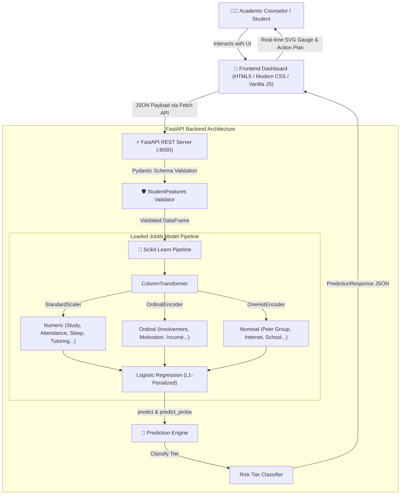

# 🎓 EduRisk AI — Student Academic Risk Predictor & Early-Warning Platform

[](https://fastapi.tiangolo.com)
[](https://www.python.org/)
[](https://scikit-learn.org/)
[](LICENSE)

An end-to-end Machine Learning web platform designed to detect student academic vulnerabilities early and generate actionable, personalized intervention strategies. Built with an asynchronous **FastAPI** backend and an interactive, glassmorphic **frontend dashboard** (HTML5 / CSS3 / Vanilla JS).

---

## 📑 Table of Contents

- [Overview & Motivation](#-overview--motivation)
- [Key Features](#-key-features)
- [System Architecture](#-system-architecture)
- [Project Structure](#-project-structure)
- [Installation & Setup](#-installation--setup)
- [Running the Application](#-running-the-application)
- [How to Use the Web Application](#-how-to-use-the-web-application)
- [Machine Learning Pipeline & Model Card](#-machine-learning-pipeline--model-card)
- [REST API Reference](#-rest-api-reference)
- [Troubleshooting & FAQs](#-troubleshooting--faqs)
- [Contributing & License](#-contributing--license)

---

## 🎯 Overview & Motivation

Academic attrition and unnoticed student struggles often stem from an interplay of cognitive, behavioral, socioeconomic, and environmental factors. Traditional report cards identify problems *after* exams are failed. 

**EduRisk AI** acts as a **predictive early-warning system**:
* Ingests **17 multi-dimensional indicators** spanning study intensity, attendance, sleep balance, peer influence, family support, and resource availability.
* Employs an $L_1$-regularized **Logistic Regression Pipeline** trained on 6,607 student records.
* Provides **instant prognostic risk probability**, identifies primary risk drivers, and prescribes concrete intervention steps for academic counselors and educators.

---

## ✨ Key Features

### 1. ⚡ Real-Time Live Diagnostic Mode
* Moving any slider or clicking a toggle recalculates the student risk score **instantly in real time** with debounced async queries.
* Live prediction can be toggled on/off in the header.

### 2. 🎛️ Animated Circular Radial Speedometer
* SVG radial speedometer with fluid transition physics and glowing drop-shadows.
* Real-time rolling numeric counter smoothly animating probabilities from $0.0\%$ to $100.0\%$.
* Dynamic color shifts across three clinical tiers:
  * 🟢 **Low Risk / On Track** ($< 40\%$)
  * 🟡 **Moderate / Borderline Risk** ($40\% - 70\%$)
  * 🔴 **Critical Academic Risk** ($\ge 70\%$)
* Built-in zero-dependency **Confetti Celebration 🎊** when evaluating low-risk profiles!

### 3. 👥 Interactive Archetype Benchmark Cards
Pre-configured persona benchmarks loadable with a single click:
* 🚨 **Alex M. (High Risk Archetype)**: 65% attendance, 10h study, negative peer influence, no tutoring.
* 📊 **Jordan T. (Moderate / Borderline)**: 80% attendance, 20h study, balanced routine needing monitoring.
* 🌟 **Maya K. (Honor Roll / Safe)**: 96% attendance, 35h study, high parental engagement.
* 🔄 **Custom Draft**: One-click reset to standard baseline values.

### 4. 📊 Comparative Metrics vs Baseline
Visual progress bars benchmarking the student against target standards for:
* **Attendance Rate** (Target: $\ge 90\%$)
* **Weekly Study Intensity** (Target: $\ge 25\text{ hrs}$)
* **Previous Exam Scores** (Target: $\ge 80$)
* **Daily Sleep & Recovery** (Target: $7 - 8\text{ hrs}$)

### 5. 🛡️ AI Risk Drivers & Prescriptive Action Plan
* **Protective Factors vs Risk Contributors**: Automatic feature attribution separating what is shielding the student from what is exacerbating risk.
* **Targeted Intervention Checklist**: Generates concrete next steps (e.g., *mandatory attendance tracking*, *scheduled 3-hr daily guided study block*, *departmental peer tutoring*, *sleep hygiene counseling*).

### 6. 💡 "What-If" Auto-Optimization & Export Brief
* **Auto-Optimize to Low Risk**: Interactive simulator that automatically adjusts high-leverage factors to demonstrate how an at-risk student can transition into the safe zone.
* **Copy Diagnostic Brief**: Copies a formatted academic assessment report to clipboard for counselor case notes with a toast notification.

### 7. 🌓 Dark & Light Mode Support
* Modern glassmorphic theme with ambient mesh glows.
* Dark / Light toggle in the top-right header with state persisted across browser sessions via `localStorage`.

---

## 🏗️ System Architecture



---

## 📁 Project Structure

```text
AIML project/
├── .gitignore                          # Excludes venv, pycache, OS files from git
├── requirements.txt                    # Root Python dependencies for one-command install
├── README.md                           # Complete project documentation & manual
├── StudentPerformanceFactors.csv       # Training & validation dataset (6,607 records)
├── student_risk_logreg_model.joblib    # Serialized scikit-learn pipeline (preprocessing + model)
├── notebook.ipynb                      # Exploratory Data Analysis (EDA) & model training notebook
│
├── backend/
│   ├── app.py                          # FastAPI core application (endpoints, schemas, static mounts)
│   ├── main.py                         # Multi-mode entrypoint alias for uvicorn
│   └── requirements.txt                # Backend dependencies specification
│
└── frontend/
    ├── index.html                      # Semantic UI with categorized inputs & analytics dashboard
    ├── css/
    │   └── style.css                   # Glassmorphism design system, dark/light theme, SVG animations
    └── js/
        └── app.js                      # Live evaluate engine, gauge math, presets, confetti, export
```

---

## 💻 Installation & Setup

### Prerequisites
* **Python 3.9, 3.10, or 3.11** installed on your system.
* Git installed.

### 1. Clone the Repository
```bash
git clone https://github.com/YOUR_USERNAME/AIML-project.git
cd "AIML project"
```

### 2. Create a Clean Python Virtual Environment

> [!IMPORTANT]
> The trained model (`student_risk_logreg_model.joblib`) was built with **scikit-learn 1.6.1**. Always use a dedicated virtual environment (`venv`) to prevent version conflicts with global Python or Conda installations.

* **macOS / Linux:**
  ```bash
  python3 -m venv venv
  source venv/bin/activate
  ```

* **Windows (Command Prompt / PowerShell):**
  ```cmd
  python -m venv venv
  venv\Scripts\activate
  ```

### 3. Install Dependencies
```bash
pip install --upgrade pip
pip install -r requirements.txt
```

---

## 🚀 Running the Application

### Start the FastAPI Server

From the project root directory, run:

```bash
uvicorn backend.main:app --reload --port 8000
```

*(Alternatively, run using the virtual environment's Python binary directly:)*
```bash
./venv/bin/python -m uvicorn backend.main:app --reload --port 8000
```

When started, your terminal will confirm:
```text
INFO:     Started server process
INFO:     Waiting for application startup.
✅ Model loaded successfully from .../student_risk_logreg_model.joblib
INFO:     Application startup complete.
INFO:     Uvicorn running on http://127.0.0.1:8000 (Press CTRL+C to quit)
```

### Accessing the Interfaces
* 🌐 **Web Dashboard:** [http://127.0.0.1:8000](http://127.0.0.1:8000)
* 📖 **Interactive Swagger UI:** [http://127.0.0.1:8000/docs](http://127.0.0.1:8000/docs)
* 📑 **Alternative ReDoc UI:** [http://127.0.0.1:8000/redoc](http://127.0.0.1:8000/redoc)

---

## 📖 How to Use the Web Application

1. **Select an Archetype Benchmark**:
   * Click on **Alex M. (High Risk)**, **Jordan T. (Moderate)**, or **Maya K. (Honor Roll)** to immediately populate the form and observe how the dashboard responds.
2. **Fine-Tune Indicators**:
   * **Academic Habits**: Adjust *Weekly Study Hours*, *Attendance Rate*, *Previous Exam Scores*, and *Tutoring Sessions*.
   * **Lifestyle & Sleep**: Modify *Daily Sleep Duration* and *Physical Activity*.
   * **Family & Environment**: Select *Parental Involvement*, *Family Income*, *Parent Education*, and *Distance from School*.
   * **School Climate**: Select *Peer Circle Influence*, *Teacher Quality*, *School Type*, and *Resource Access*.
3. **Live Diagnostic Feedback**:
   * Watch the **Circular Speedometer** update in real time. Notice how increasing *Attendance* above 90% and *Study Hours* above 25 drastically reduces the probability of risk.
4. **Inspect Recommendations**:
   * Review the **Protective Factors** and **Risk Contributors** lists.
   * Review the **Prescriptive Intervention Steps** generated for the student.
5. **Simulate Interventions ("What-If" Analysis)**:
   * Click **💡 Auto-Optimize to Low Risk** to automatically simulate recommended adjustments and watch the gauge drop into the safe green zone.
6. **Export Findings**:
   * Click **📋 Copy Diagnostic Brief** to copy a formatted academic assessment brief ready to paste into counselor notes or student folders.

---

## 🧠 Machine Learning Pipeline & Model Card

### Dataset
* **Source:** `StudentPerformanceFactors.csv` (6,607 records).
* **Target Construction:** Students with `Exam_Score < 65` were mapped to target label `Needs_Support = 1`, and $\ge 65$ to `Needs_Support = 0`.

### Feature Taxonomy & Preprocessing
The model embeds an automated Scikit-Learn `ColumnTransformer`:
1. **Numerical Features** (Imputed via `median`, standardized via `StandardScaler`):
   * `Hours_Studied`, `Attendance`, `Sleep_Hours`, `Previous_Scores`, `Tutoring_Sessions`, `Physical_Activity`
2. **Ordinal Categorical Features** (Imputed via `most_frequent`, encoded via `OrdinalEncoder`):
   * `Parental_Involvement`, `Access_to_Resources`, `Motivation_Level`, `Family_Income`, `Teacher_Quality`, `Parental_Education_Level`, `Distance_from_Home`
3. **Nominal Categorical Features** (Imputed via `most_frequent`, encoded via `OneHotEncoder`):
   * `Extracurricular_Activities`, `Internet_Access`, `School_Type`, `Peer_Influence`, `Learning_Disabilities`

### Model Weights & Interpretability
Trained using **Logistic Regression** with $L_1$ penalty (`liblinear` solver, `class_weight="balanced"`):
* **Top Protective Factors (Negative weights):** High Attendance ($-13.46$), Study Hours ($-10.49$), Parental Involvement ($-6.02$), Access to Resources ($-5.89$), Internet Access ($-5.65$).
* **Top Risk Drivers (Positive weights):** Negative Peer Influence ($+11.17$), Learning Disabilities without accommodation ($+5.74$), Far Distance from School ($+2.83$).

---

## 🔌 REST API Reference

### 1. Health & Readiness Check
```http
GET /api/health
```
**Response:**
```json
{
  "status": "ok",
  "model_loaded": true
}
```

---

### 2. Predict Student Academic Risk
```http
POST /api/predict
Content-Type: application/json
```

**Request Body Example:**
```json
{
  "Hours_Studied": 18,
  "Attendance": 78,
  "Sleep_Hours": 6,
  "Previous_Scores": 68,
  "Tutoring_Sessions": 1,
  "Physical_Activity": 2,
  "Parental_Involvement": "Medium",
  "Access_to_Resources": "Medium",
  "Motivation_Level": "Medium",
  "Family_Income": "Medium",
  "Teacher_Quality": "Medium",
  "Parental_Education_Level": "College",
  "Distance_from_Home": "Moderate",
  "Extracurricular_Activities": "Yes",
  "Internet_Access": "Yes",
  "School_Type": "Public",
  "Peer_Influence": "Negative",
  "Learning_Disabilities": "No"
}
```

**Response Example (`200 OK`):**
```json
{
  "prediction": 1,
  "probability": 0.7241,
  "label": "Needs Support",
  "risk_level": "High Risk"
}
```

---

## 🛠️ Troubleshooting & FAQs

### Q1: `ModuleNotFoundError: No module named 'backend'`
* **Cause:** You ran `uvicorn backend.main:app` while your terminal was already inside the `backend/` directory.
* **Fix:** `cd ..` back to the project root directory, then run `uvicorn backend.main:app --reload --port 8000`.

---

### Q2: `InconsistentVersionWarning` or `_RemainderColsList` AttributeError
* **Cause:** Your active Python environment has a newer scikit-learn version (e.g., 1.9+) that changed internal unpickling APIs.
* **Fix:** Ensure you activate the project's virtual environment which uses `scikit-learn==1.6.1`:
  ```bash
  source venv/bin/activate
  pip install -r requirements.txt
  ```

---

### Q3: `[Errno 48] address already in use: ('127.0.0.1', 8000)`
* **Cause:** Another process is already running on port 8000.
* **Fix:** Either kill the previous process or specify an alternate port:
  ```bash
  uvicorn backend.main:app --reload --port 8001
  ```
  *(The frontend automatically detects and connects to port 8001 as well!)*

---

## 📄 License & Acknowledgments

* **License:** Distributed under the MIT License.
* **Dataset Credit:** Kaggle Student Performance Factors dataset.
* Built with modern standards for educational data science and proactive academic support.
